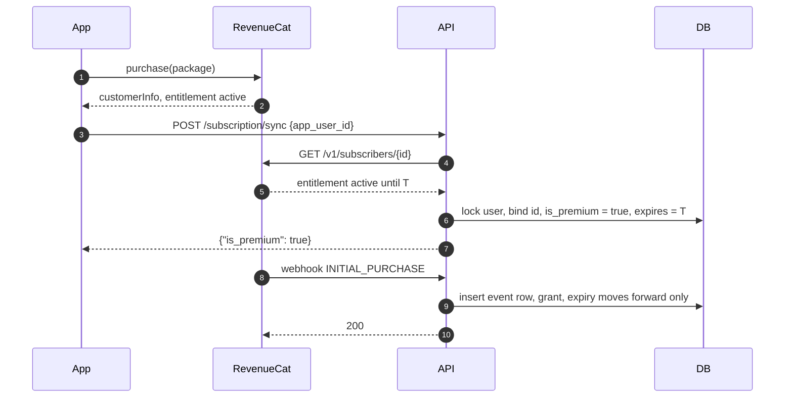
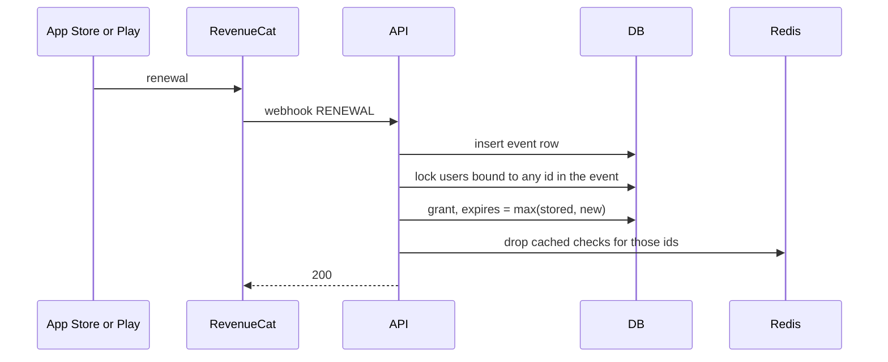
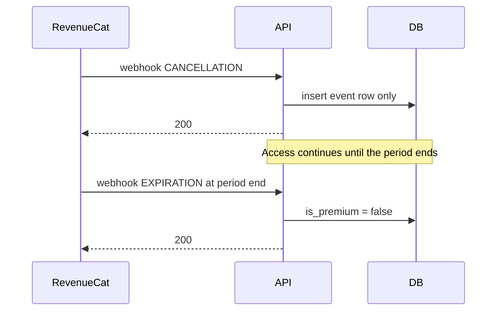
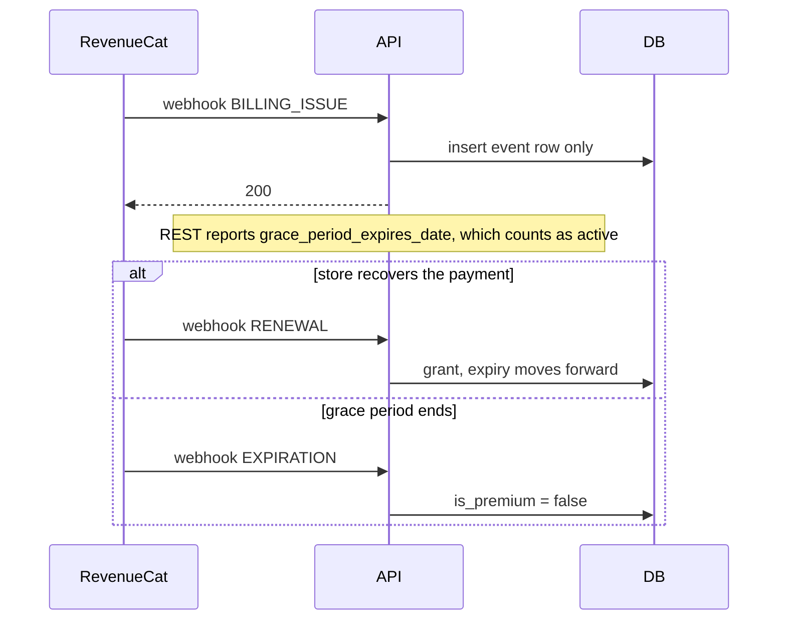
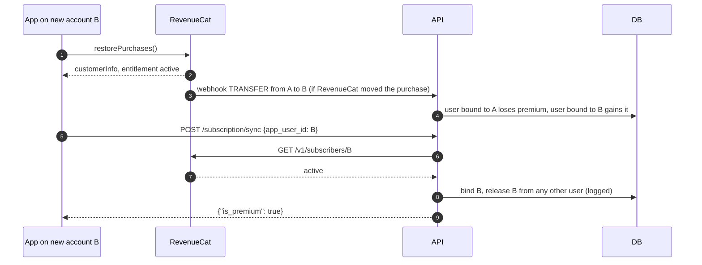

# Architecture

## Components

```
app/
  api/        HTTP layer: routes, request and response schemas, dependencies
  core/       settings, logging, errors, auth, shared clients
  db/         SQLAlchemy models, session, row lock helpers
  services/   RevenueCat logic with no FastAPI imports
scripts/      reconcile job
migrations/   Alembic
```

Rules between layers:

* `services` never imports from `api`. Services take a session, a Redis client and an HTTP client as arguments, so they are easy to test and to call from scripts.
* `api` stays thin. A route parses input, calls one service function and shapes the response.
* Only `services/entitlements.py` talks to the RevenueCat REST API. The webhook, the sync endpoint, the premium gate and the reconcile job all go through it, so the sandbox rule and status mapping cannot drift apart.
* The rules for changing premium fields live in `services/subscription_state.py`, and the webhook, the sync endpoint and the reconcile job all use them. The one other write is the bind, which clears the fields on a user who loses a RevenueCat id to someone else.

Runtime pieces:

* **Postgres** holds users, their bound RevenueCat id, a mirror of premium state, and one row per processed webhook event.
* **Redis** caches REST results for a few minutes and holds the daily quota counters. Losing Redis costs extra REST calls and turns costly features off. It never grants access.
* **RevenueCat** is the source of truth for whether a purchase is active.

## Sources of truth

| Question | Who answers | Notes |
|---|---|---|
| Is this RevenueCat id active right now? | RevenueCat REST | Cached briefly. Called before any route that needs premium. |
| What happened to a subscription? | Webhook | Moves the stored mirror forward. The only writer once it has touched a row. |
| Which RevenueCat id belongs to which user? | Verified sync | A client sends the id; the server binds it only after REST confirms it is active. |
| What the client says | Nobody | A client can ask the server to check. It can never set premium itself. |

The stored mirror (`is_premium`, `premium_expires_at`) is used in two cases: users without a RevenueCat id (accounts you grant by hand) and RevenueCat outages. In both cases the expiry is enforced.

## Flows

### Purchase



The webhook and the sync can arrive in either order. If the webhook comes first and nobody has bound the id yet, it is recorded and skipped, and the sync does the binding a moment later. If the webhook has already written a bound row, the sync leaves its fields alone.

### Renewal



### Cancellation



A user who turns auto renew off has paid for the rest of the period. Refunds also arrive as CANCELLATION; RevenueCat removes the entitlement right away, and since every event drops the cached check, the next premium check sees it.

### Billing issue



### Restore on a new device or account



The sync is what binds the id. TRANSFER only moves premium between users that are already bound, so it never hands an account to someone by itself.

## Concurrency

* The webhook inserts its event row first. A second delivery of the same event fails on the unique `event_id` and returns `duplicate`.
* User rows are locked with `SELECT ... FOR UPDATE` in id order. On Postgres every such transaction sets `lock_timeout`, so a stuck lock becomes a 503 instead of a hung request.
* RevenueCat is never called while a lock is held. The sync checks RevenueCat first, then locks.
* The bind itself runs in a savepoint. If another request binds the same id in between, the unique index rejects ours and the sync reports the row as it is.
